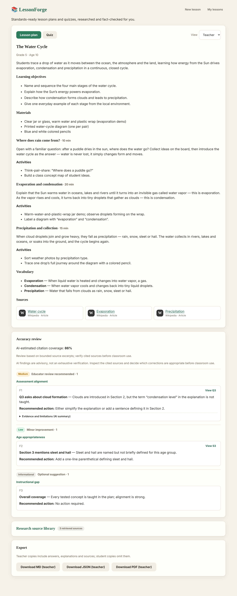
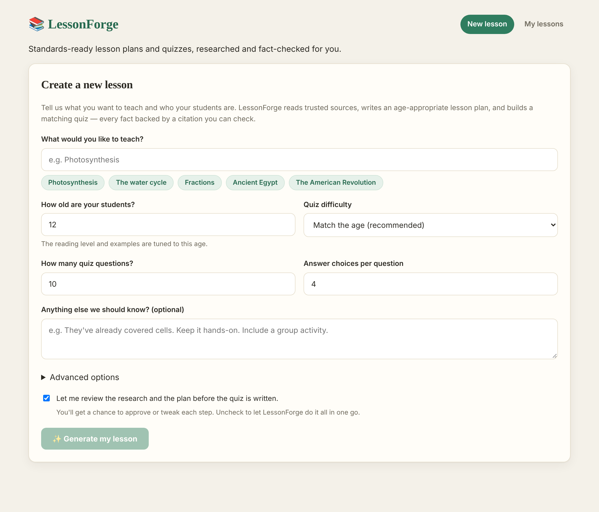
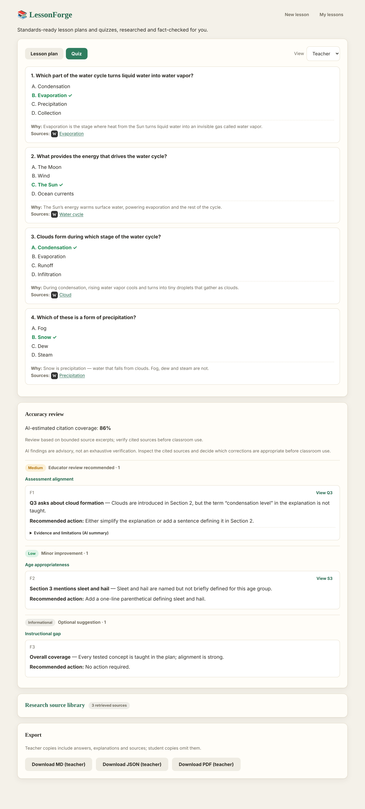

# LessonForge

[](https://github.com/dvdhtzr/LessonForge/actions/workflows/ci.yml)
[](LICENSE)


**Turn a topic and a target age into a complete, citation-backed lesson plan and quiz — generated
entirely on your own machine.** LessonForge runs a crew of local AI agents over a rights-reviewed
research index, with the teacher in the loop at every step and every fact linked to a source you
can open.

No cloud services. No API keys. Nothing leaves your computer except the requests that fetch public,
rights-eligible source material.



---

## What it does

Type what you want to teach (*“The water cycle”*) and who you're teaching (*age 10*). LessonForge:

- 🔎 **Researches** the topic against rights-reviewed sources (Wikipedia, Wikibooks, USGS, and
  reviewed public-domain / CC0 catalogs) and builds a fresh per-run RAG index.
- 📝 **Plans** an age-calibrated lesson: objectives, sections, activities, vocabulary and materials.
- ❓ **Writes a quiz** — multiple-choice questions with answer keys and citation-backed explanations.
- ✅ **Fact-checks** the result against the retrieved evidence, surfacing advisory findings by
  severity without rewriting the teacher's approved work.
- 👩‍🏫 **Keeps you in control** — review and edit the research and the plan before the quiz is written.
- 📄 **Exports** to Markdown, JSON or PDF, in separate student and teacher variants.

Every claim carries a citation, and a teacher-only **source library** records the exact provenance
(provider, license, rights scope, retrieval time, content hash) of everything admitted to the index.

## Screenshots

| Create a lesson | Quiz with answer key |
|---|---|
| [](docs/images/new-lesson.png) | [](docs/images/quiz-review.png) |

## How it works

```
React/TS (Vite)  ──HTTP + SSE──▶  ASP.NET Core API  ──▶  MAF workflow crew  ──▶  Ollama (local)
   web/                            LessonForge.Api         LessonForge.Core          gemma4:latest
                                   SQLite (results)        RAG index (in-memory)     nomic-embed-text
```

A [Microsoft Agent Framework](https://github.com/microsoft/agent-framework) workflow wires five
executors with typed DTOs and two human-in-the-loop review gates:

| Stage | Persona | Does |
|-------|---------|------|
| Research | Research Librarian | Retrieves enabled Wikipedia/Wikibooks text, relevant USGS observations and rights-scoped catalog metadata; validates permissions and embeds eligible evidence in a per-run index |
| *optional* | **Perspective Analyst** | When enabled, finds substantiated differing interpretations — or explicitly reports no substantive disagreement / insufficient evidence |
| *gate* | — | Educator reviews / edits / approves the grounded facts |
| Lesson Planner | Curriculum Designer | Builds an age-calibrated plan: objectives, sections, activities, vocabulary |
| *gate* | — | Educator reviews / edits / approves the plan |
| Quiz Generator | Assessment Writer | Writes MCQs (default 10 × 4 options, difficulty auto-scaled to age) with citation-backed explanations |
| Fact-Check | Accuracy Editor | Reviews claims and answers against retrieved evidence; returns compact, severity-ranked findings without rewriting the approved lesson |

The API streams the run as Server-Sent Events (`run` → `stage*` → `gate*` → `complete` → `done`),
so the UI shows real stage progress and pauses at each review gate.

## Engineering highlights

The interesting parts are in how the system refuses to fake things. Full detail in
[`docs/implementation-notes.md`](docs/implementation-notes.md):

- **Fail-closed rights gate.** Source content reaches embeddings or a model prompt only when a
  trusted adapter has recorded its license, scope, policy URL, review date and AI-processing
  permission. An enabled-source flag is never a rights grant. OpenStax is a worked example: its
  text is *blocked at API startup* because its license forbids generative-AI ingestion.
- **Bounded fact-check that can't silently pass.** The Accuracy Editor audits in small batches,
  rejects truncated (`finish_reason=length`) output, retries ambiguous batches as single items,
  and fails closed rather than report a successful review it didn't actually complete.
- **Deterministic identity & completeness guards.** Named subjects are never swapped for a
  fuzzy similar-name match; unfinished research summaries get one bounded, evidence-grounded
  repair and otherwise fail with a clear error — no guessing to complete a cut-off sentence.
- **Evidence-gated perspectives.** The optional Perspective Analyst must ground each viewpoint in
  retrieved citations or return an explicit *insufficient evidence* result. It will not manufacture
  a controversy, and a one-shot stricter-prompt recovery guards against plausible-but-unverifiable
  output.
- **In-memory RAG, no vector DB.** A small hand-rolled cosine-similarity index over the standard
  `IEmbeddingGenerator` abstraction — built fresh each run, discarded after, and trivially testable.

## Tech stack

- **Backend:** C# / .NET 10, ASP.NET Core minimal API, Microsoft Agent Framework, EF Core + SQLite,
  QuestPDF for exports.
- **Frontend:** React 19 + TypeScript (Vite), React Router, TanStack Query, oxlint.
- **Models (local):** Ollama running `gemma4:latest` (agents) and `nomic-embed-text:v1.5` (embeddings).
- **Tests:** xUnit — 30 test files covering the chunker, vector index, source clients (fixture-based),
  rights gate, DTO serialization and exporters.

---

## Quickstart

### Prerequisites

- [.NET 10 SDK](https://dotnet.microsoft.com/download/dotnet/10.0) (the SDK, not just the runtime)
- [Node.js 22.12+ or 24+](https://nodejs.org/)
- [Ollama](https://ollama.com/download)
- Git

### Windows — one command

```powershell
git clone https://github.com/dvdhtzr/LessonForge.git
cd LessonForge
.\scripts\start.ps1
```

`start.ps1` checks tool versions, starts Ollama if needed, pulls any missing models (several GB on
first run), installs frontend dependencies, launches the API and Vite, waits for both, and opens
**http://localhost:5173**. The launcher refuses to start if ports 5173/5174 are already in use.

### macOS / Linux — manual

```bash
ollama pull gemma4:latest
ollama pull nomic-embed-text:v1.5
```

```bash
# terminal 1 — API on http://localhost:5174
dotnet run --project LessonForge.Api --launch-profile http
```

```bash
# terminal 2 — web on http://localhost:5173
cd web && npm ci && npm run dev
```

Local LLM inference needs no paid API; the research step needs internet access to reach public
sources. No environment variables, secrets or model subscriptions are required.

## Configuration

Runtime settings live in committed, non-secret files — never environment variables or secrets.

**Models & limits** — [`LessonForge.Api/appsettings.json`](LessonForge.Api/appsettings.json):
`ChatModel`, `EmbeddingModel`, `Endpoint`, `MaxOutputTokens` (8192), `NetworkTimeoutSeconds` (600),
`MaxRetries` (0). The API logs its resolved model configuration on startup. To change a model, edit
the file and `ollama pull` the matching tag.

**Sources** — [`LessonForge.Api/appsettings.Local.json`](LessonForge.Api/appsettings.Local.json):
boolean switches per provider. Invalid or unknown switches fail at startup rather than silently
using an unexpected source set. This file tracks source switches only — **no credentials belong in
it.**

### Source rights at a glance

| Provider ID | Default | AI evidence allowed? | Scope |
|---|---:|---|---|
| `wikipedia-text` | ✅ | Yes | CC BY-SA article text; cite original |
| `wikibooks-text` | ✅ | Yes | CC BY-SA instructional page text; cite chapter |
| `usgs-earthquakes` | ✅ | Yes | USGS-authored observation fields |
| `loc-century-of-lawmaking` | ✅ | Yes | Public-domain collection catalog descriptions |
| `gutenberg-catalog` | ✅ | Yes | Official public-domain catalog **metadata only** |
| `smithsonian-openaccess-metadata` | ✅ | Yes | Per-record CC0 museum catalog **metadata only** |
| `openstax-text` | ❌ | **No** — prior written permission required | CC BY-NC-SA + explicit prohibition on generative-AI ingestion |

An enabled flag is never a legal permission grant: every candidate document must still pass the
`SourcePermissionGate` before embedding and agent input, and attribution / share-alike obligations
still apply downstream. Full provider-by-provider policy and the retrieval-integrity review are in
[`docs/source-registry.md`](docs/source-registry.md).

## Project layout

- **`LessonForge.Core`** — config, Ollama client factory, RAG pipeline (`Rag/`), agents (`Agents/`),
  DTOs (`Dto/`), workflow (`Workflow/`).
- **`LessonForge.Api`** — minimal-API host: generate (SSE), gate, list/get, export; SQLite
  persistence; Markdown / JSON / PDF exporters (student & teacher variants).
- **`LessonForge.Tests`** — xUnit: chunker, vector index, source clients (fixtures), rights gate,
  DTO JSON, exporters.
- **`web/`** — React + TypeScript (Vite): new-lesson form, live run view with review gates, lesson
  view (plan / quiz tabs, student / teacher toggle, export), history.

## API endpoints

| Method | Route | Purpose |
|--------|-------|---------|
| POST | `/api/lessons/generate?interactive=true` | Start a run; streams SSE |
| POST | `/api/lessons/gate/{runId}` | Approve / edit / abort a review gate |
| GET | `/api/lessons` | List saved lessons |
| GET | `/api/lessons/{id}` | Fetch a saved lesson |
| GET | `/api/lessons/{id}/export?format=md\|json\|pdf&audience=student\|teacher` | Download |

## Development

### Continuous integration

Every push to `main` and every pull request runs
[`.github/workflows/ci.yml`](.github/workflows/ci.yml) on GitHub-hosted runners, in two parallel jobs:

- **.NET build & test** — restores, builds in Release, and runs the full xUnit suite on the .NET 10 SDK.
  The tests use fixtures / fakes, so no Ollama server or live network source is required.
- **Web lint, type-check & build** — `npm ci`, then `oxlint`, then `tsc` + `vite build`.

### Running the checks locally

The same checks that run in CI can be run before pushing. The unit tests need no running Ollama
server or live sources.

```bash
./scripts/check.sh      # macOS / Linux
```

```powershell
.\scripts\check.ps1     # Windows
```

A successful run prints `==> All local checks passed.` and must not do so if any command fails.
The `scripts/` directory also contains focused `build`, `test` and `web` scripts and Windows setup
and launch helpers.

## License

Licensed under the [Apache License 2.0](LICENSE) — see `LICENSE` and `NOTICE`.
